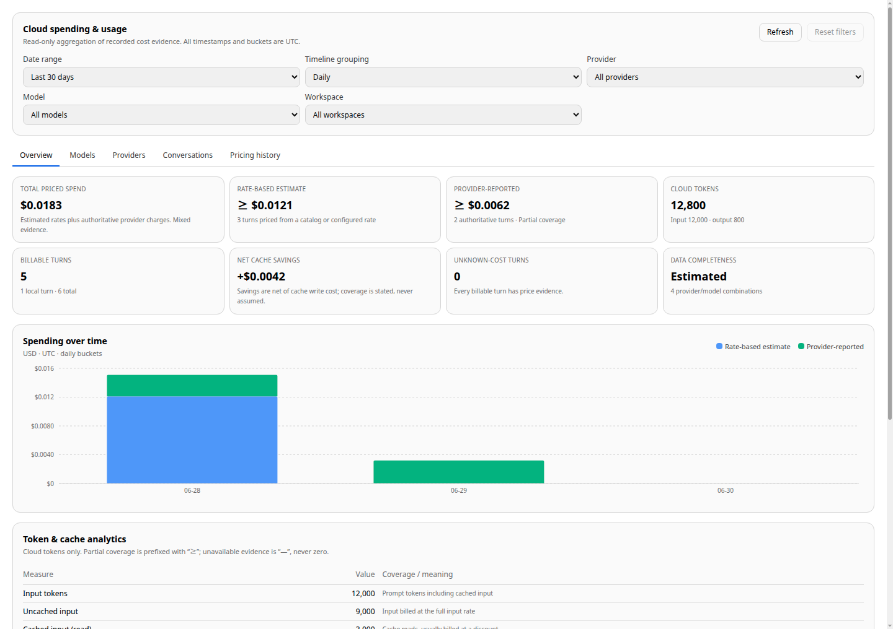

# Cloud Spending & Usage Dashboard — Phase 2.0D

Status: implemented and verified. This phase adds a native, read-only cloud
spending dashboard inside Continuum's existing Settings surface. It reuses the
token and cost evidence already persisted by Phase 2.0C-1 and Phase 2.0C-3. It
does not create a second analytics store, a separate server, or a new pricing
engine.

**No paid inference was performed.** No request was sent to Anthropic,
OpenAI, OpenRouter, or any other paid endpoint. No pricing API was called and no
hosted infrastructure was introduced.



---

## 1. User-facing surface

Settings now has a dedicated **Usage & Costs** tab next to the existing
**Usage & Logs** tab. The existing token-history and engine-log panels are
unchanged.

The dashboard has five sections:

| Section | Content |
|---|---|
| **Overview** | Spend metrics, data completeness, spending timeline, token/cache analytics, top models. |
| **Models** | Sortable/searchable model table with per-provider identity and a detail panel. |
| **Providers** | Spend and token totals by provider, including local usage-only rows. |
| **Conversations** | Attribution by conversation, workspace, main agent/sub-agent, provider, or model, plus paginated detailed records. |
| **Pricing history** | The rate snapshots recorded with historical turns, with expansion for missing evidence and timestamps. |

Shared filters apply to every section: date range, timeline grouping, provider,
model, and workspace. Custom ranges accept inclusive UTC start/end dates. The
filter dropdown options remain stable while one value is selected, so choosing a
provider does not hide the other providers from the list.

All buckets and displayed timestamps are explicitly labelled UTC.

---

## 2. Data source and invariants

The dashboard reads only existing SQLite evidence:

- `token_usage` — one row per parent model turn, including the cost columns and
  `cost_breakdown` JSON written by Phase 2.0C-3.
- `subagent_runs` — one row per completed child run, including its own cost
  evidence and `accounting_json` token counters.
- `sessions` and `projects` — titles and workspace names used only for labels.
- `app_settings('cloud-providers')` — current provider names, routes, and
  configured rates used only to label provider IDs.

The following rules hold everywhere:

- **No recalculation.** A historical amount is an aggregation of the stored
  `cost_total`. The current catalog or current provider rates are never applied
  backwards. Changing a provider's rates does not alter past spend; this is
  asserted by a deterministic test.
- **No inferred price.** Missing evidence stays `null`. A billable turn with no
  cost evidence is reported as unknown and excluded from spend, never as `0`.
- **Local is not applicable.** A local turn has no cloud charge. The UI renders
  **Not applicable** for its cost, not `$0.00`. Local tokens remain visible for
  usage analytics but are excluded from cloud spend and billable coverage.
- **Mixed evidence is labelled.** Rate-based estimates and authoritative
  provider-reported charges are shown separately. Their sum is called **Total
  priced spend** and is never presented as fully verified.
- **Provider identity is part of model identity.** The same model ID routed
  through Anthropic, OpenRouter, or a local endpoint produces separate rows.
  Unknown or deleted provider IDs remain distinct and are labelled
  `Unrecognized provider (…)`.

---

## 3. Backend design

`src/main/spendingDashboard.js` implements five read-only functions:

| Function | Purpose |
|---|---|
| `getDashboard` | Summary, timeline, model rows, provider rows, filter options. |
| `getAttribution` | Grouped usage/spend by conversation, workspace, agent, provider, or model. |
| `getRecords` | Paginated turn/sub-agent records. |
| `getPricingHistory` | Paginated rate snapshots grouped from persisted breakdowns. |
| `getModelDetail` | One model/provider summary, timeline, and rate snapshots. |

### 3.1 Unified usage CTE

Every aggregate is built over one SQL `WITH usage AS (…)` row set:

- One row per `token_usage` parent turn in the date range.
- One row per `subagent_runs` child with `completed_at IS NOT NULL` in the date
  range.

A child is never folded into the parent's `token_usage` row, and the parent's
stored cost does not include child cost. Each billed execution therefore
appears exactly once. The attribution tests assert that chat, workspace, and
agent groupings all sum back to the same total.

Filters are applied inside both branches of the CTE. The same CTE feeds the
summary, timeline, model, provider, record, pricing, and attribution queries, so
disjoint values cannot diverge.

### 3.2 SQL-only aggregation

The renderer never receives the usage history. SQLite performs:

- `COUNT`, `SUM`, `MIN`, `MAX`, grouping, sorting, `LIMIT`, and `OFFSET`.
- Daily (`YYYY-MM-DD`), weekly (Monday-start), and monthly (`YYYY-MM-01`)
  UTC buckets.
- Zero-period filling in the main process only, capped at 1,200 periods.
- Model and provider aggregation, so the number of returned model rows is
  bounded by distinct provider/model pairs, not by turns.

All user inputs are validated and passed as SQL parameters. Pagination is
limited to 100 rows. No renderer-supplied SQL exists; there is no generic SQL
IPC bridge.

### 3.3 Additive indexes

Phase 2.0D adds only indexes:

- `idx_token_usage_provider_time(provider, timestamp)`
- `idx_token_usage_chat_time(chat_id, timestamp)`
- `idx_subagent_runs_completed_at(completed_at)`

No rows are rewritten and no schema column is added by this phase.

### 3.4 IPC and preload

Five registered handlers were added beside `tokens:history`:

- `usage:dashboard`
- `usage:attribution`
- `usage:records`
- `usage:pricing-history`
- `usage:model-detail`

The preload bridge exposes only the corresponding read methods:
`getSpendingDashboard`, `getSpendingAttribution`, `getSpendingRecords`,
`getPricingHistory`, and `getUsageModelDetail`.

---

## 4. Metric definitions

| Metric | Definition |
|---|---|
| **Total priced spend** | `SUM(cost_total)` over billable (non-local) rows. Combines rate-based and authoritative evidence. |
| **Rate-based estimate** | `cost_total` where `cost_source <> 'provider-reported'`. |
| **Provider-reported** | The authoritative `cost_total` where `cost_source = 'provider-reported'`. |
| **Cost coverage** | `measured`, `partially_measured`, `unavailable`, or `not_applicable` over billable turns. |
| **Data completeness** | `fully_measured` only when every billable turn is both priced and authoritative; otherwise `estimated`, `partially_estimated`, `unavailable`, or `not_applicable`. |
| **Unknown-cost turns** | `billableTurns - costMeasuredTurns`. Unknown is never zero. |
| **Cloud tokens** | Input + output tokens from non-local rows. Cache reads are already part of input. |
| **Net cache savings** | Stored `cost_cache_savings`, which is already net of cache-write cost. Coverage is stated. |
| **Cache read ratio** | Cached input ÷ input, shown only when cache-read coverage is fully measured. |

Coverage rules are shared by every table and card:

- `measured` — every billable turn has the field.
- `partially_measured` — some turns have it; numeric values are prefixed `≥`.
- `unavailable` — no turn has it; the value is `—`.
- `not_applicable` — there is no cloud charge, normally because the selection is
  local-only.

Tiny non-zero amounts keep the Phase 2.0C formatting contract and render as
`< $0.0001`, never `$0.00`.

---

## 5. Timeline and buckets

- Relative ranges: last 7 days, last 30 days, last 90 days, all recorded usage.
- Custom ranges: inclusive UTC start/end dates.
- Groupings: daily, weekly (Monday start), monthly.
- Default grouping follows the range: 7/30 days → daily, 90 days → weekly,
  all → monthly.
- Empty periods inside the range are returned with zero turns and `null` cost so
  the chart shows a gap, not a fabricated zero-spend month.
- The chart stacks **Rate-based estimate** and **Provider-reported** but never
  merges them into a single verified series. The accessible table below the
  chart carries the same data.

---

## 6. Attribution without double counting

`getAttribution` supports five groupings:

- **Conversation** — parent `chat_id`; child runs use `parent_session_id`.
- **Workspace** — the parent turn's recorded project or its session project;
  child runs use the parent session's project.
- **Main agent / sub-agent** — parent turns are `Main agent`; completed child
  runs are labelled `Subagent · <name>`.
- **Provider** — stored provider ID.
- **Model** — provider ID + model ID, so the same model on two routes stays
  separate.

Missing or unknowable ownership is grouped as **Unattributed**. Deleted or
renamed chats and workspaces keep their recorded IDs in the label. No
relationship is guessed.

Detailed records are loaded only when expanded and are paginated at 25 rows per
page. Each row states whether it is a parent turn or a sub-agent run. Message
content is never loaded.

---

## 7. Pricing history

The pricing-history view is derived from the `cost_breakdown` JSON snapshots
already stored by Phase 2.0C-3. Rows are grouped by:

`provider_id`, `model_id`, `cost_source`, `cost_version`, `currency`, and the
stored breakdown.

Each row shows:

- source and pricing kind (verified catalog, provider metadata, user-configured,
  authoritative provider charge, unavailable, not applicable);
- recorded version;
- input/output/cache rates in USD per million tokens;
- first and last observation timestamps;
- number of turns and recorded cost;
- missing fields, if any.

The database records when an estimate was written, not a provider's published
effective date. The dashboard therefore displays **Effective date unavailable**
instead of inventing one. Expanding a row explains that changing today's
catalog does not rewrite the row.

Pricing history is paginated at 25 rate snapshots per page.

---

## 8. Model detail

Selecting a model opens a detail panel with:

- estimated, provider-reported, and total priced spend;
- cache savings, input/cached/cache-write/output/reasoning tokens;
- turns, billable vs local turns, and unknown-cost turns;
- coverage and data-completeness labels;
- a model-specific spending timeline;
- the recorded rate snapshots for that provider/model pair.

Provider ID is always passed with the model ID so a model name shared by two
providers resolves to the correct identity.

---

## 9. Honest states

The dashboard distinguishes:

| State | Presentation |
|---|---|
| No usage at all | Empty-period chart, zero turns, `unavailable` coverage. |
| Usage with no price evidence | `—` cost, unknown-cost turns, explicit note. |
| Partially priced usage | `≥` numeric values and `partially_measured` coverage. |
| All billable turns authoritative | `fully_measured` data completeness. |
| Estimate-only history | `estimated` data completeness. |
| Local-only selection | `Not applicable` cost; local token counts remain visible. |
| Mixed local/cloud | Cloud totals exclude local; local turns are stated separately. |
| Backend/filter error | Inline alert with the actual message; previous view is not replaced by a fake zero. |

---

## 10. Security, performance, and scope

- Read-only: no `INSERT`, `UPDATE`, or `DELETE` exists in the dashboard module.
  A test asserts SQLite `data_version` is unchanged after all five reads.
- Parameterized: every filter and page value is bound, never interpolated.
- Bounded: records and pricing history are paginated; model/provider rows are
  aggregated; timeline periods are capped.
- Offline: the module has no network code. A test replaces `global.fetch` with a
  throwing function and confirms dashboard reads still succeed.
- No inference: the UI test records every IPC method and asserts only the five
  read methods were called.
- Additive only: no cache, compaction, budget, token-history, or pricing-engine
  behavior is changed. Historical evidence is never rewritten.

### Development compatibility

Renderer code must not import project `.cjs` files directly. Vite's dev server
serves those files as CommonJS without synthesizing an ESM default export, which
produced `does not provide an export named 'default'`. `src/lib/costFormat.mjs`
therefore contains the two renderer-facing presentation helpers and
`tests/costFormat.test.mjs` asserts their output is identical to
`cloudPricing.cjs` for nulls, tiny amounts, and ordinary values. Pricing logic
itself remains in the main-process module.

Explicitly out of scope: spending limits, alerts, quotas, export, scheduled
reports, automatic refresh, and any Phase 2.0E work.

---

## 11. Files added or changed

Added:

- `src/main/spendingDashboard.js`
- `src/components/settings/usage/UsageCostsDashboard.jsx`
- `src/components/settings/usage/SpendingTimeline.jsx`
- `src/components/settings/usage/ModelSpendingTable.jsx`
- `src/components/settings/usage/ModelDetailPanel.jsx`
- `src/components/settings/usage/ProviderBreakdownTable.jsx`
- `src/components/settings/usage/AttributionView.jsx`
- `src/components/settings/usage/PricingHistoryView.jsx`
- `src/components/settings/usage/usageDashboardFormat.mjs`
- `tests/cloudSpendingDashboard.test.cjs`
- `tests/cloudSpendingDashboard.ui.cjs`
- `tests/costFormat.test.mjs`
- `tests/fixtures/spendingDashboard.jsx`
- `docs/cloud-spending-dashboard-report.md`
- `docs/cloud-spending-dashboard.png`

Changed:

- `src/main/ipcHandlers.js` — five read-only handlers.
- `src/preload.js` — five read-only bridge methods.
- `src/main/db.js` — three additive indexes.
- `src/components/main-app/MemorySettings.jsx` — `Usage & Costs` tab and panel.
- `tests/memorySettings.ui.cjs` — ten-tab expectation and nested-tabpanel scope.
- `tests/fixtures/memorySettings.jsx` — stubs for pre-existing search, sub-agent
  budget, and dashboard settings APIs used by the settings render.

---

## 12. Verification

### 12.1 Focused backend tests

```
node --test tests/cloudSpendingDashboard.test.cjs
```

Result: **pass**. The test covers 21 scenario groups, including:

- empty database and unavailable coverage;
- global and custom filter validation;
- inclusive UTC custom dates;
- parent/child aggregation counted once;
- local `not_applicable` and unknown-cost separation;
- estimated vs provider-reported totals;
- token/cache analytics and mixed coverage;
- daily zero-fill, Monday weeks, monthly buckets;
- provider/model/workspace/chat filters;
- stable filter options under an active selection;
- all five attribution groupings;
- record pagination and completion filtering;
- pricing snapshot grouping, rates, and absent effective dates;
- model detail without repricing;
- no database writes;
- historical costs unchanged after provider rates change;
- unknown/local/unattributed provider labels;
- no network access;
- a 1,500-row fixture proving aggregation and bounded pagination;
- IPC/preload registration and absence of a generic SQL bridge.

A focused run of the dashboard plus Phase 2.0C pricing, caching, token, IPC,
provider, metadata, and migration suites produced **87 pass / 1 fail**. The one
failure is the pre-existing `cloudIpc.test.cjs` environment failure already
present in the baseline (`cloud settings persist privately and cloud chat works
without a local engine`), not a dashboard regression.

### 12.2 Focused UI tests

```
npx electron tests/cloudSpendingDashboard.ui.cjs
```

Result: **pass**. It verifies the overview metrics, chart, UTC labels, theme
variables, provider filtering, local `Not applicable`, tiny-cost formatting,
model table and detail, provider breakdown, attribution, sub-agent grouping,
paginated records, pricing history, error recovery, and that only the five
read-only methods were invoked.

The related UI suites also pass:

- `tests/cloudCostHistory.ui.cjs`
- `tests/cacheTokenHistory.ui.cjs`
- `tests/tokenHistory.ui.cjs`
- `tests/memorySettings.ui.cjs`

`memorySettings.ui.cjs` was updated for the new tenth tab and to scope its
single-visible-panel check to top-level panels, because the dashboard contains a
valid nested tablist. Its fixture also gained stubs for settings APIs introduced
earlier in the working tree; product behavior was not changed to satisfy the
test.

### 12.3 Full suite comparison

Command: `node --test tests/*.test.*`

| | Baseline | After Phase 2.0D |
|---|---:|---:|
| Tests | 1,392 | 1,394 |
| Passed | 1,366 | 1,368 |
| Failed | 25 | 25 |
| Skipped | 1 | 1 |

The 25 failing test identities are identical to the pre-existing baseline. No
new failure was introduced. The additional tests are the new dashboard backend
suite and a renderer/backend cost-formatting parity check.

### 12.4 Production build

```
npm run build
```

Result: **success**. Vite emitted only its existing chunk-size advisory; no
compile or transformation error occurred.

---

## 13. Limitations

- Only persisted evidence is shown. Rows created before Phase 2.0C-3 have no
  cost evidence and are reported as unknown, not reconstructed.
- The combined total mixes rate-based estimates with authoritative charges. It
  is deliberately not labelled as fully verified.
- Provider effective dates are unavailable; only first/last observation times
  exist.
- Workspace attribution follows the recorded token project or the session's
  current project. There is no historical workspace-membership snapshot.
- Conversation titles are current labels; deleted or unnamed chats fall back to
  a recorded-ID label.
- Pricing history groups by the full stored breakdown. Two textually different
  breakdowns for the same effective rates appear as separate snapshots rather
  than being merged.
- The dashboard is a local, on-demand view. It performs no background refresh,
  polling, export, quota enforcement, or alerting.
